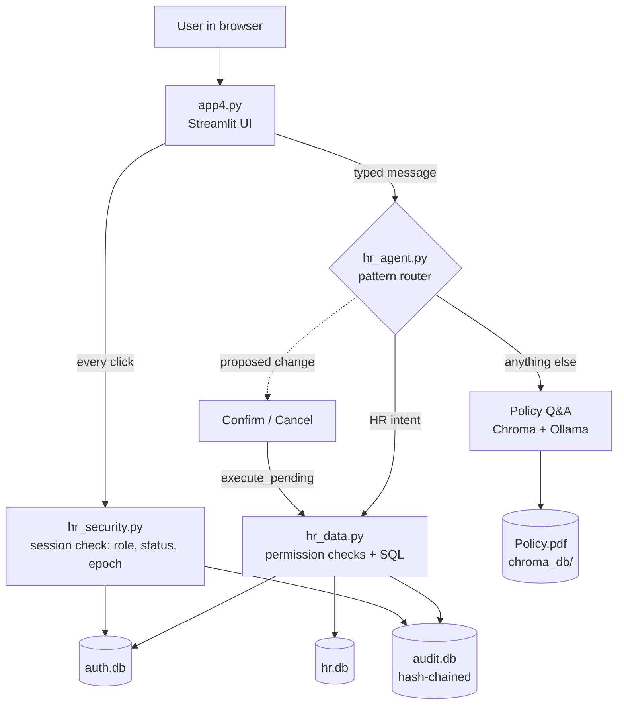

# GlobalCorp HR Policy Assistant

Streamlit app that answers policy questions from `Policy.pdf` (Ollama + Chroma) and also looks up and updates
HR records through chat. All data in the HR database is **synthetic** (30 fictional people, `@globalcorp.example`
emails, `+1-555-01xx` phone numbers).

## Files

| File | Purpose |
|---|---|
| `app5.py` | UI and policy Q&A. Your CSS and UI wording are unchanged. |
| `hr_security.py` | Passwords, lockout, sessions, two-step sign-in (TOTP), audit log, file permissions |
| `hr_data.py` | HR database, synthetic data, leave rules, permission-checked reads and writes |
| `hr_agent.py` | Turns chat messages into HR actions, confirmation flow, output sanitising, rate limits |
| `manage.py` | Operator commands: reset password / MFA, unlock, verify audit log |
| `tests/test_hr.py` | 43 tests: `python -m unittest discover -s tests -v` |
| `.streamlit/config.toml` | Upload limit, XSRF protection, no stack traces for users |

## First run

1. `pip install -r requirements.txt`, make sure Ollama is running with `nomic-embed-text` and `llama3.2:3b`.
2. `streamlit run app4.py`
3. On an empty install the app creates `auth.db` and `employee_dbs/hr.db` and seeds the synthetic company.
   Every account gets a **random one-time password** written to `initial_credentials.txt` (owner-only).
   Hand them out, then **delete that file**. Everyone must choose their own password at first sign-in.
4. Upgrading an existing install: your accounts are kept. Any account still using `ChangeMe!1/2/3` is given a
   random password (written to the same file) and forced to change it.

Roles in the demo data: `E001` and `E004` HR admins; `E002`, `E005`-`E008` managers; the rest employees.

## What the chat can do

| Ask | Who can | Notes |
|---|---|---|
| "Is Carol on leave?", "When will Bob be back?", "Who is on leave next week?" | everyone | Dates and return date only. Leave type is visible to the person, their manager and HR. Pending requests are never shown. Back-to-back leave is merged, and weekends and company holidays are skipped. |
| "My leave balance", "Show my leave requests" | you | Annual 18, sick 10, casual 6 per year (editable in `leave_allotments`) |
| "Apply for leave from 14 Oct to 16 Oct", "sick leave tomorrow", "I'll be off next week" | you | Goes to your manager (or HR) for approval |
| "Pending leave requests", "Approve leave 12", "Reject leave 12 because ..." | managers (their reports), HR | Nobody can approve their own request |
| "Show my details", "Who is my manager?", "What's Priya's email?" | everyone | You see everything about yourself; managers see more about direct reports; others see name, title, department, email, location |
| "Update my phone to ...", "Update my address to ...", "Update my emergency contact to Jane Doe, +1-555-0123" | you | |
| "Change the department of Aarav to Finance", "Make E010 report to E002", "Mark E010 as terminated" | HR admins | Cannot change their own title, department, manager, status or pay band. Roles and passwords cannot be changed from chat. |

Every change shows a summary and needs **Confirm** (button, or typing "yes"). Anything not recognised goes to the
policy assistant, so "How many annual leaves can I take?" is still answered from the PDF.

**Why not let the model call the database directly?** A 3B model is unreliable at tool use, and text in a PDF or a
chat message could talk it into a change. Here the language model never reads or writes HR data. Fixed patterns turn
*your typed message* into an action, permissions are checked in code, and you confirm every write.

## Security changes (all 9 findings, plus the corrections)

1. **Backdoor accounts removed.** No more `INSERT OR REPLACE` at start-up; passwords survive restarts; lockout counters are not reset.
2. **Lockout and timing.** 5 failures lock the ID for 30 s, doubling to 15 min. Unknown IDs are counted too, so locking does not reveal who exists. A dummy hash runs for unknown IDs, so timing is equal. PBKDF2 raised to 600,000 rounds, old hashes upgrade on next login.
3. **Role re-checked on every click**, from the database. Demoted, disabled or password-reset accounts lose access immediately. The policy download and all admin actions re-check at the moment of use.
4. **Upload hardening.** 10 MB limit, `%PDF-` check, 300-page limit, unique temp file, one update at a time, hashed and timestamped backups (last 10 in `policy_versions/`), generic error text for users, details to the log and audit trail.
5. **Rebuild cannot wipe the index.** The new index is built in a new collection; the live one is deleted only after the new one is complete and switched on. The new PDF replaces `Policy.pdf` only after it has been indexed.
6. **LLM hardening.** Only the last 6 policy turns (1,500 chars each) reach the model, HR-data replies never do. Input limit 1,000 chars and 20 messages per 5 min per user. Policy text sits inside `<policy_excerpts>` in the user message, declared as data, with `<` and `>` neutralised. Model output has images, links, bare URLs and HTML removed before display, which closes the image-URL data leak.
7. **Sessions** end after 30 min idle or 8 h total, and when the password changes. Sign-out clears the whole session.
8. **File permissions.** `auth.db`, `employee_dbs/`, `chroma_db/`, `policy_versions/`, `Policy.pdf` and the credentials file are owner-only (POSIX; best effort on Windows).
9. **Audit log** (`employee_dbs/audit.db`): append-only with a hash chain; HR admins see it in the sidebar with an integrity check. **Google Fonts** are no longer loaded (set `HR_ALLOW_EXTERNAL_FONTS=1` to restore Inter).

Also added: password policy (12+ chars, common-password and name checks), optional two-step sign-in (TOTP, replay-proof),
password change screen, and stored text is escaped before display so one user's data cannot inject markup into another's view.

## Settings (environment variables)

`HR_DATA_DIR` (where the databases live, default current folder), `HR_IDLE_TIMEOUT_MIN` (30),
`HR_SESSION_MAX_HOURS` (8), `HR_ALLOW_EXTERNAL_FONTS` (off).

## Known limits

- **Not tested here:** the Ollama/Chroma parts (`setup_rag_pipeline`, rebuild, upload) could not be run in my sandbox. The logic around them was exercised with stubs, but please try an upload and a rebuild once.
- **No per-IP throttling.** Streamlit does not expose the client IP. Lockout is per account. Put a reverse proxy in front for IP limits and **TLS, which is essential**, since passwords cross the network.
- **Tamper evidence, not tamper proofing.** Someone with write access to the server's files can rewrite the audit log and re-chain it. Copy the log off the server for real assurance.
- The MFA secret is stored in `auth.db` unencrypted and protected by file permissions.
- Lost authenticator device: `python manage.py reset-mfa E001`.
- Dates like "14 Oct" with no year mean the next time that date comes round (up to 7 days in the past counts as backdating). The confirmation always shows the full dates before anything is saved.
# Architecture

## Overview

| Module | Responsibility |
|---|---|
| `app4.py` | UI, sign-in screens, sidebar, policy upload and index rebuild, policy Q&A call |
| `hr_security.py` | Password hashing, lockout, sessions, TOTP, audit log, file permissions. Stdlib only |
| `hr_data.py` | Schema, synthetic data, leave rules, every read and write of HR data, with permission checks |
| `hr_agent.py` | Chat message to action, confirmation flow, output sanitising, rate limiting |
| `manage.py` | Operator-only tasks (reset password / MFA, unlock, verify audit log) |

## Data model

- `auth.db` / `employees`: login identity, role (`employee`, `manager`, `hr_admin`), manager, active flag, password hash, session epoch, MFA fields.
- `hr.db` / `employee_profile`: email, phone, department, title, location, hire date, address, emergency contact, pay band.
- `hr.db` / `leave_requests`, `leave_allotments`, `holidays`.
- `audit.db` / `audit_log`: append-only (database triggers), each row hashed with the previous row's hash.

`hr.db` attaches `auth.db` so that a change touching both (for example deactivating a person) is one transaction.
Name, role, manager and active status live only in `auth.db`; they are never duplicated.

## Request flow for a chat message

1. `sync_session()` re-reads the user from `auth.db` (role, active, session epoch) and checks idle/absolute timeouts.
2. Length and rate limits are applied.
3. `hr_agent.handle()` matches the message against fixed patterns. A match produces either a read-only answer or a
   *pending action* held server-side in the session, with an expiry.
4. The user confirms with a button (or "yes"). `execute_pending()` re-checks the actor and calls `hr_data`, which
   re-checks permissions, validates input, writes, and records an audit entry.
5. If nothing matches, the message goes to the policy Q&A pipeline, and the model's answer is sanitised before display.

## Security model

**The language model never touches HR data.** It only answers policy questions. Actions come from the user's own
typed message via fixed patterns, so instructions hidden in a PDF, or in model output, cannot trigger a change.

| Threat | Control |
|---|---|
| Stolen or guessed passwords | PBKDF2-SHA256 (600k rounds), 12+ character policy, progressive lockout, optional TOTP |
| Account discovery | Same message and equal CPU cost for unknown and known IDs; lockout tracked per ID string |
| Stale privileges | Role and status re-read on every interaction; password change and deactivation end other sessions |
| Privilege escalation via chat | Permissions enforced in `hr_data.py`, not in the UI or the model; roles and passwords not editable from chat |
| Self-dealing | Nobody approves their own leave; HR cannot change their own title, manager, status or pay band |
| Prompt injection | Policy text delimited and declared as data; history and input capped; no model-driven actions |
| Data exfiltration through rendered output | Images, links, URLs and HTML removed from model output; database values markdown-escaped |
| Malicious uploads | Size, magic-byte and page limits; unique temp file; indexed before replacing the live file |
| Losing the knowledge base | New index built in a new collection and activated atomically |
| Silent tampering | Append-only audit log with hash chain; `manage.py verify-audit` |

### Out of scope / known limits

TLS and per-IP rate limiting belong in a reverse proxy. Files are protected by permissions, not encryption.
The audit hash chain is tamper-evident, not tamper-proof, against someone with write access to the server.

